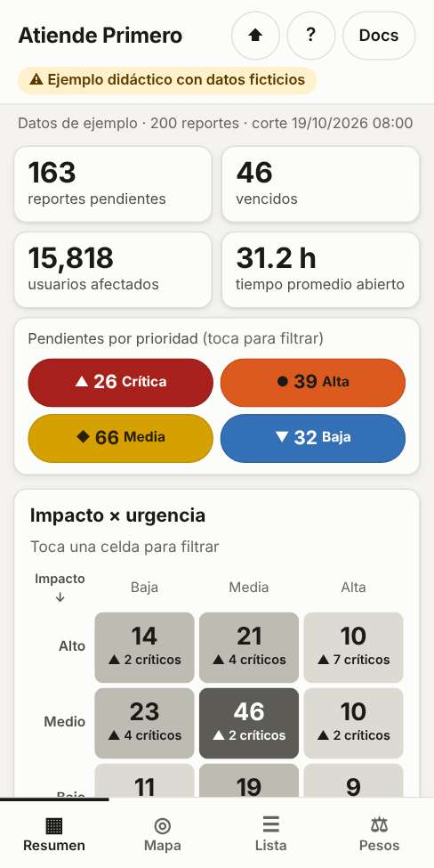
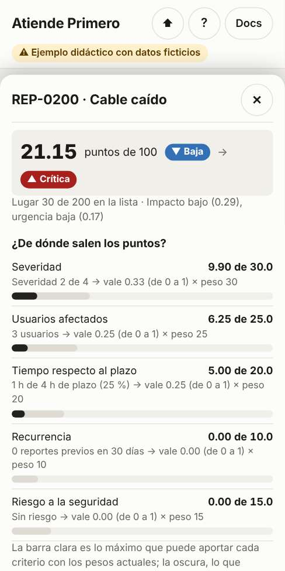
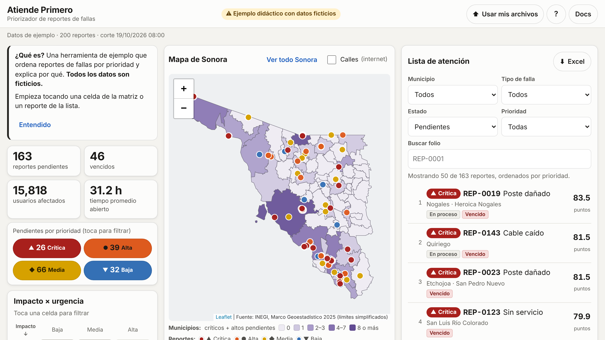

# Atiende Primero · priorizador de reportes de fallas

> ⚠️ **Ejemplo didáctico con datos ficticios.** No es un sistema oficial ni está avalado por ninguna institución.
> Los 200 reportes son inventados.

Herramienta web que **lee reportes de fallas desde Excel**, calcula una **prioridad explicable** (criterios con pesos
editables y reglas duras) y la muestra en un **mapa de los municipios de Sonora**, una **matriz de impacto y
urgencia** y una **lista de atención**. Todo se calcula en el navegador: ningún dato sale del dispositivo.

**Pruébala en línea:** https://rolandogr.github.io/atiende-primero/ · o descarga el proyecto y abre
`sitio/index.html` con doble clic.

<p>
  
  
</p>



## Contexto
Se preparó como ejemplo para una charla sobre IA y toma de decisiones dirigida a mandos medios y altos de la
**CFE** en Hermosillo, Sonora. El objetivo es que la audiencia:
1. **la use** desde su celular (entrando por un código QR);
2. **replique el proceso** con Claude Code;
3. **la adapte** a su propia área.

Por eso el proceso está tan documentado como el software.

Se construyó con **Claude Code** en 7 fases. En cada una la IA propuso opciones, una persona decidió, y todo quedó
en la [bitácora](docs/bitacora.md).

## Qué hace
- **Abre con datos de ejemplo** y un recorrido guiado corto.
- **Indicadores:** pendientes, por prioridad, vencidos, usuarios afectados y tiempo promedio abierto.
- **Matriz 3 × 3** de impacto contra urgencia. Tocar una celda filtra todo.
- **Mapa** con los municipios coloreados por reportes críticos y altos, y los reportes como puntos.
- **Lista de atención** ordenada, con filtros, y **detalle** que explica cuánto aportó cada criterio y qué regla
  subió la prioridad.
- **Pesos en vivo:** mueve un peso y todo se reordena. El enlace comparte tus pesos (no tus datos).
- **Tus propios Excel:** carga, valida con mensajes claros y exporta la lista priorizada.
- **Funciona sin conexión** una vez abierta, y también con doble clic.

### Cómo calcula la prioridad
Puntaje de 0 a 100 = suma de (peso × valor de cada criterio, de 0 a 1). Los criterios son severidad, usuarios
afectados, tiempo respecto al plazo, recurrencia y riesgo a la seguridad. Los umbrales dan la prioridad, y las
**reglas duras** pueden subirla pero nunca bajarla: un cable caído siempre es crítico.

Detalle y dos ejemplos calculados a mano: [docs/modelo.md](docs/modelo.md).

## Documentación
| Documento | Para qué |
|---|---|
| [Guía para replicar](docs/guia-replicar.md) | Construir algo así con Claude Code en la web, paso a paso y con todos los prompts |
| [Adaptar a mi área](docs/adaptar-a-mi-area.md) | Cambiar datos, criterios y reglas; usarla para otro tipo de tareas |
| [Limitaciones](docs/limitaciones.md) | Qué no hace, qué decide una persona y qué haría falta para usar datos reales |
| [Bitácora](docs/bitacora.md) | Cada instrucción, pregunta, respuesta y decisión del proceso |
| [Modelo](docs/modelo.md) | La fórmula y ejemplos calculados a mano |
| [Datos](docs/datos.md) | Qué contiene cada columna y cómo se generaron los datos ficticios |
| [Mapa](docs/mapa.md) | Fuentes del INEGI, términos de uso y cómo se simplificó el mapa |
| [Validación](docs/validacion.md) | Pruebas de pantallas, accesibilidad, conexión, velocidad y privacidad |
| [CLAUDE.md](CLAUDE.md) | Contexto y convenciones para Claude Code |

Dentro del sitio, [documentacion.html](sitio/documentacion.html) resume todo en lenguaje claro para quien llega
por QR.

## Estructura
```
sitio/       ← lo único que se publica: index.html, documentacion.html, css/, js/, lib/, datos/, descargas/, img/
datos/       reportes.xlsx y criterios.xlsx de ejemplo (editables)
scripts/     generar_datos.py (datos ficticios), preparar_mapa.sh y preparar_localidades.py (INEGI)
pruebas/     pruebas del cálculo (node --test) y del navegador (Playwright y axe-core)
docs/        documentación, bitácora y capturas
```

## Comandos
```bash
# Usar la herramienta
#   abrir sitio/index.html con doble clic, o servirla:
python3 -m http.server -d sitio 8000

# Regenerar los datos de ejemplo (semilla fija: archivos idénticos en cada ejecución)
python3 -m pip install -r scripts/requirements.txt
python3 scripts/generar_datos.py

# Pruebas (requiere Node.js; una sola vez: npm install y npx playwright install chromium)
npm test               # cálculo y lectura de Excel
npm run humo           # recorrido básico en el navegador
npm run validacion     # pantallas, accesibilidad, sin conexión, velocidad, privacidad
npm run capturas       # regenera las imágenes de sitio/img/
```

## Publicar
El sitio es estático: basta con publicar la carpeta `sitio/` en cualquier servicio de páginas. Este proyecto usa
**GitHub Pages con GitHub Actions** (los pasos se completan en la Fase 6).

## Privacidad
- Sin servidor, base de datos, analítica, cookies ni rastreo.
- La página bloquea cualquier conexión de red. La única excepción es la capa opcional de calles de OpenStreetMap,
  que viene apagada y avisa antes de activarse.
- Los archivos que cargues se procesan en tu navegador y **no salen de tu dispositivo**.
- **No cargues datos reales de ninguna institución.**

## Fuentes y licencias
- Fuente: INEGI, Marco Geoestadístico, Encuesta Intercensal 2025 (límites municipales, simplificados).
- Fuente: INEGI, Censo de Población y Vivienda 2020 (población y localidades).

  Los datos geográficos fueron transformados para este ejemplo; no son una representación oficial ni el INEGI
  avala este proyecto. Ver [docs/mapa.md](docs/mapa.md).
- Bibliotecas incluidas: Leaflet 1.9.4 (BSD-2-Clause) y SheetJS Community Edition 0.20.3 (Apache 2.0). Ver
  [sitio/lib/VERSIONES.md](sitio/lib/VERSIONES.md).
- **Código:** MIT. **Documentación y datos ficticios:** CC BY 4.0.

## Créditos
Hecho por [RolandoGR](https://rolandogr.github.io) con [Claude Code](https://claude.com/claude-code).
